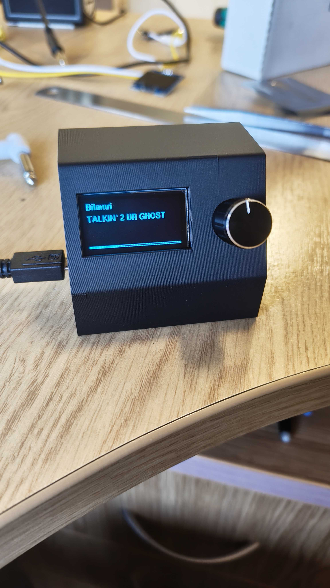

# SpotifyThing

A Raspberry Pi Pico W project that shows the currently playing Spotify track on an SH1106 OLED display. Supports play/pause, skip, and volume control via a rotary encoder.



<video src="images/video-1.mp4" controls></video>

## Hardware

| Part | Details |
|---|---|
| Microcontroller | Raspberry Pi Pico W |
| Display | SH1106 128×64 OLED (I2C, address 0x3C) |
| Input | KY-040 rotary encoder |

**Wiring:**

| Signal | GPIO |
|---|---|
| Display SDA | GP16 |
| Display SCL | GP17 |
| Encoder CLK | GP20 |
| Encoder DT | GP19 |
| Encoder SW | GP18 |

## Controls

| Action | Result |
|---|---|
| Rotate encoder | Adjust volume in 10% steps |
| Single press | Toggle play / pause |
| Double press | Skip to next track |

## Setup

### 1. Install PlatformIO

Install the [PlatformIO IDE extension](https://platformio.org/install/ide?install=vscode) for VS Code, or the PlatformIO Core CLI.

### 2. Clone the repo

```
git clone <repo-url>
cd SpotifyThing
```

### 3. Create a Spotify app

1. Go to the [Spotify Developer Dashboard](https://developer.spotify.com/dashboard) and create an app.
2. Add `http://127.0.0.1:3000/callback` as a redirect URI.
3. Note your **Client ID** and **Client Secret**.

### 4. Get a refresh token

A script is included to handle the OAuth flow automatically. It opens a browser for you to authorise, captures the callback, and saves the tokens to `spotify_tokens.txt`.

**Install dependencies:**

```bash
pip install requests python-dotenv
```

**Create a `.env` file** in the project root:

```
SPOTIFY_CLIENT_ID=your-client-id
SPOTIFY_CLIENT_SECRET=your-client-secret
```

**Run the script:**

```bash
python get_spotify_token.py
```

It will open your browser, wait for you to log in and authorise, then print and save your tokens. Keep the `REFRESH_TOKEN` value for step 6.

### 5. Flash

For the first flash, or if the device has crashed, hold the BOOTSEL button while plugging in USB, then run:

```
pio run -t upload
```

After that, BOOTSEL isn't needed. The running firmware reboots itself into BOOTSEL when you upload:

```
pio run -t upload --upload-port COMx
```

`COMx` is the Pico W's serial port. Always pass it on the command line: the `upload_port = D:\` in `platformio.ini` is stale.

### 6. Configure the device

While the firmware runs, the Pico W mounts as a small USB drive of about 240 KB. No BOOTSEL is needed, but you do need a computer: a power-only USB source shows no drive.

1. Create `config.txt` in the root of the drive, containing only the keys you want to change. See [`config.txt.example`](config.txt.example):

   ```
   WIFI_SSID=your-ssid
   WIFI_PASS=your-password
   SPOTIFY_CLIENT_ID=your-client-id
   SPOTIFY_CLIENT_SECRET=your-client-secret
   SPOTIFY_REFRESH_TOKEN=your-refresh-token
   ```

2. Eject the drive. Always eject: unplugging without ejecting may lose the file, though a `config.txt` found at boot is also imported.
3. The OLED shows `Config saved` or `Config rejected`, then `Restarting...`, and the device reboots. If WiFi is currently retrying, this can take up to about 9 seconds.

The drive reappears after the reboot. You don't configure an access token: the device fetches one at boot using the refresh token.

**An import erases the entire drive, including any other files on it.** `config.txt` is wiped whether it was saved or rejected, so a rejected file must be re-created.

Prefer creating `config.txt` directly on the drive. If you keep a copy in the repo root, `config.txt` is gitignored. In VS Code, close the tab for `F:\config.txt` without saving after the import, since saving writes the secrets back to the drive.

#### File format

- One `KEY=VALUE` per line, split on the first `=`. Keys are case-sensitive.
- Values are used verbatim, including spaces, so don't put spaces around the `=`.
- There are no comments: any non-blank line without `=` is rejected, as is any unknown key.
- Blank lines are ignored, and CRLF line endings and a UTF-8 BOM are tolerated.
- The maximum file size is 4 KB.

| Key | Length |
|---|---|
| `WIFI_SSID` | 1–32 bytes. Required on a blank device |
| `WIFI_PASS` | Empty (open network) or 8–63 bytes |
| `SPOTIFY_CLIENT_ID` | 1–64 bytes |
| `SPOTIFY_CLIENT_SECRET` | 1–64 bytes |
| `SPOTIFY_REFRESH_TOKEN` | 1–511 bytes |

Validation is all-or-nothing: if any line is rejected, nothing changes.

#### Checking the result

`status.txt` on the drive shows the current state and the last import, with a line number where relevant. It never contains secret values:

```
WIFI_SSID: your-ssid
WIFI_PASS: set
SPOTIFY_CLIENT_ID: set
SPOTIFY_CLIENT_SECRET: set
SPOTIFY_REFRESH_TOKEN: not set
Stored credentials: yes
Last import: rejected: unknown key (line 3)
```

If setup is incomplete, the OLED says so:

| OLED | Meaning |
|---|---|
| `Setup needed` / `Add config.txt to USB` | No WiFi set |
| `Spotify not set up` / `Add config.txt to USB` | Spotify keys missing |

#### Where credentials are stored

Credentials are kept in plain text in the 4 KB EEPROM flash sector, outside the USB drive region, and survive firmware uploads. They can't be read through the drive, but **anyone with USB access can read flash using picotool**, because the RP2040 has no secure storage.

## Project structure

```
src/
├── main.cpp           # setup() and loop() entry points
├── display.h/cpp      # SH1106 rendering, scroll logic, volume overlay
├── wifiManager.h/cpp  # WiFi connection
├── spotify.h/cpp      # Spotify API client (fetch, token refresh, controls)
├── userControls.h/cpp # Encoder input and gesture detection
├── credentials.h/cpp  # Credential storage in the EEPROM flash sector
└── usbConfig.h/cpp    # USB drive, config.txt import, status.txt
lib/
└── ky-040/            # KY-040 encoder driver
```

## Country code

The firmware defaults to `CYW43_COUNTRY_UK`. If you're in a different region, update the `build_flags` in `platformio.ini`:

```ini
build_flags = -DCYW43_COUNTRY=CYW43_COUNTRY_USA
```

A full list of country codes is in the [Pico W SDK docs](https://www.raspberrypi.com/documentation/microcontrollers/raspberry-pi-pico.html).
